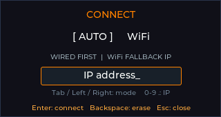
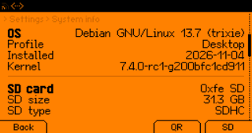
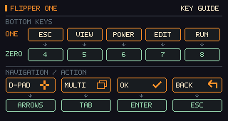

# FlipCTL for CardputerZero

A FlipCTL client for CardputerZero. Display and control Flipper One over wired Ethernet or LAN WiFi, with a 320×170 LVGL interface showing the remote 256×144 grayscale screen.

## Screenshots

These 320×170 screenshots were captured on CardputerZero. The connection page uses the documentation address `192.0.2.10`; no real target was contacted, and no device identifiers or actual network settings are shown.

| Auto connection | Remote system info |
| --- | --- |
|  |  |

| H key guide | Active remote view |
| --- | --- |
|  |  |

See the [screenshot notes](docs/screenshots/README.md) for the isolated capture procedure. These images show the client interface; real remote screens are not included as promotional assets.

## Connection and controls

The app tries Ethernet on startup. If no wired stream is available, it opens the **CONNECT** page. Press **W** to open or close this page at any time. Use **Tab**, **Left**, or **Right** to switch between the two modes:

- **Auto** first tries the wired target at `192.168.50.2:8899`. The entered IP is the WiFi fallback target. Auto also works without a fallback address.
- **WiFi** connects to the entered Flipper One IPv4 address. CardputerZero and the target must be reachable on the same local network.

Enter an IP with the number and period keys. **Backspace** deletes one character, **Delete** clears the field, **Enter** saves and connects, and **Esc** closes the page. The saved WiFi address is stored locally at `$XDG_CONFIG_HOME/flipctl/wifi-ip`, or `~/.config/flipctl/wifi-ip` by default. On disconnection, the remote image is hidden and a connection status is shown.

| CardputerZero key | Action |
| --- | --- |
| Arrow keys or I / J / K / L | Navigate up / left / down / right |
| F / X / Z / C | Navigate up / down / left / right |
| Enter | Confirm |
| Tab | Switch remote apps |
| Short Esc or Backspace | Back |
| 4 / 5 / 6 / 7 / 8 | Remote Esc / View / Power / Edit / Run |
| V / B / A | Edit / Run / Push-to-talk |
| W | Toggle local connection settings |
| H | Toggle the pixel-art key guide, including from connection settings |
| Short Esc while the guide is open | Close the guide |
| Hold Esc for about 900 ms | Exit FlipCTL |

The remote image always stretches to fill the 320×170 display. Connection-page editing and guide controls are handled locally. The remote protocol exposes semantic buttons rather than text input; use the remote on-screen keyboard to enter text. The Power action sends a power-button event to the remote device.

## Build and deploy

```sh
sh build.sh
python3 tests/test_protocol.py
sh deploy.sh pi@cardputerzero.local
```

Building requires an AArch64 Linux GNU C/C++ toolchain, Python 3.8 or later, and a compatible AArch64 sysroot with libc, FreeType, libpng, and zlib development files. The device needs Python 3, fbdev/evdev permissions, and the matching dynamic libraries. Check device dependencies with `ldd /usr/share/APPLaunch/apps/flipper-one-remote/flipper-one-remote`. The Python bridge and source-packaging tools use only the standard library.

The default build compiles LVGL from source, then links the client. It does not depend on another app's prebuilt LVGL archive. The included `config/lvgl_config.h` enables Linux fbdev, RGB565, and the required fonts. The complete source archive includes the actual LVGL sources; a regular Git checkout requires you to supply them separately. See the [release guide](docs/RELEASE.md) for dependency provenance, the pinned revision, and source-archive instructions.

Inside the original UserDemo tree, the build automatically locates the SDK's LVGL sources and the RFID sysroot. For a standalone checkout:

```sh
export LVGL_SYSROOT=/path/to/aarch64-sysroot
# The complete source archive includes third_party/lvgl.
# For a regular checkout, set the directory containing lvgl/lvgl.h:
export LVGL_INCLUDE_DIR=/path/to/directory-containing-lvgl
sh build.sh
```

Use `CC`, `CXX`, and `AR` to select the toolchain. In the main build script, `CXX` must identify the compiler executable. Set `LVGL_CONFIG_HEADER` to override the configuration, or `LVGL_STATIC_LIBRARY` to explicitly reuse a library built with the same configuration.

The key-guide artwork and embedded pixel data are included. Normal builds do not require Pillow. To regenerate the artwork, install Pillow and run `python3 design/key-guide/make_preview.py`.

Deployment installs files under `/usr/share/APPLaunch/` using SSH/SCP and restarts the user-level `APPLaunch.service`. Use SSH keys, or set `SSHPASS` with sshpass installed. Set `SUDO_PASSWORD` if sudo needs a separate password. Credentials are not stored in project files. Override the wired target with `FLIPPER_ONE_HOST`. The full installed-file list is in `install.sh`; uninstall by removing the app directory, launcher script, desktop entry, and icon.

## Debian package

Package the current tested executable without rebuilding it:

```sh
python3 tools/package_deb.py
```

This requires `dpkg-deb` and an AArch64-capable `readelf`. It produces `dist/flipper-one-remote_0.1.0_arm64.deb` and a SHA-256 checksum. Packaging runs without root and verifies the control metadata, complete file inventory, ownership, modes, embedded executable bytes, and 256×256 icon. Files are owned by root, with executable mode only for the client and launcher. Gzip compression and normalized timestamps make the package reproducible with identical inputs and packaging-tool versions; `SOURCE_DATE_EPOCH` defaults to `0` and can be set explicitly.

Copy the package to CardputerZero, then install it there with dependency resolution:

```sh
sudo apt install ./flipper-one-remote_0.1.0_arm64.deb
```

The current executable requires `libc6 (>= 2.38)`, so it is not compatible with Debian 12's default glibc 2.36. Other dependencies are Python 3.8 or later, FreeType, zlib, GCC/C++ runtime libraries, and either `libpng16-16` or `libpng16-16t64`. The package targets the existing CardputerZero APPLaunch environment. It installs no services or maintainer scripts and does not change users or device permissions. Restart APPLaunch in the existing user session if its application list is cached. Distribute the package with its matching complete corresponding source archive as described in the [release guide](docs/RELEASE.md).

## Implementation

`main/bridge.py` uses the Python standard library. GET `/stream` receives a little-endian `<4H` rectangle header followed by grayscale data. POST `/input` sends `{key,down}` events. The bridge handles partial screen updates, bounds checks, timeouts, and reconnection. The GUI receives complete frames over a local Unix datagram socket and reads the device keyboard through evdev. On exit it releases remote buttons and reaps the bridge process. WiFi and Ethernet sockets bind to `wlan0` and `eth0`, respectively.

## Network and privacy

The client has no telemetry, cloud account, or built-in credentials. Remote `/stream` and `/input` requests use unencrypted HTTP without authentication; use them on trusted networks.

The saved WiFi address remains in the device's local configuration directory. Hardware-test logs and raw captures may contain network addresses or device identifiers, so they are excluded from source packaging. This README uses only the reviewed screenshots in `docs/screenshots/`.

## License and assets

Original project code and pixel artwork are licensed under [GNU GPL v3](LICENSE), SPDX identifier `GPL-3.0-only`. The app icon is derived from Flipper Android App artwork and retains its [MIT license and copyright notice](share/images/ICON_LICENSE.txt). See the [icon provenance](share/images/ICON_SOURCE.md) for details.

Statically linked LVGL code, Montserrat / FontAwesome fonts, and LodePNG retain their respective licenses; see the [third-party inventory](share/licenses/README.md). Deployment installs these notices alongside the app. Executable releases must provide the corresponding project and LVGL sources, configuration, and build scripts. See the [release guide](docs/RELEASE.md). Source publication and app-store submission are tracked separately; `PUBLISH.md` is the store-submission draft.
